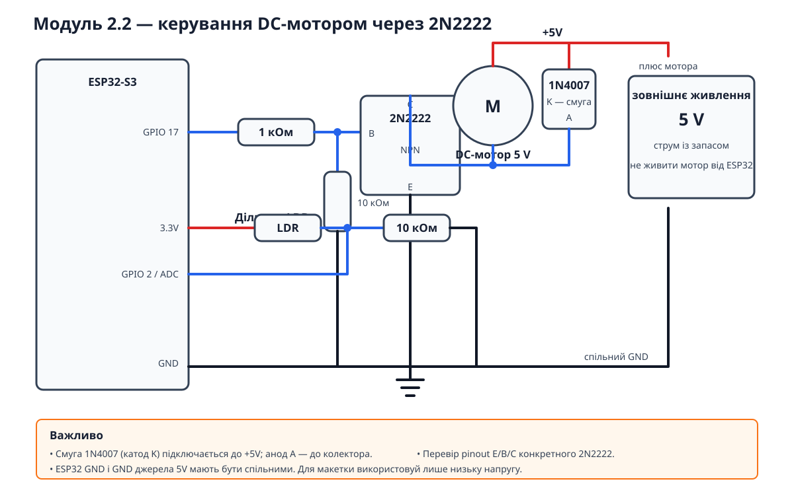

# Урок 10 — Модуль 2.2

## Пасивні/активні компоненти: керування потужним навантаженням

ESP32-S3 керує малим DC-мотором через NPN-транзистор 2N2222/PN2222A.
Діод 1N4007 гасить імпульс самоіндукції під час вимкнення мотора та
захищає транзистор і мікроконтролер.



## Компоненти

- ESP32-S3;
- малий DC-мотор 5 V;
- 2N2222 або PN2222A;
- резистор бази 1 кОм і підтягувальний резистор 10 кОм;
- захисний діод 1N4007;
- LDR і резистор 10 кОм;
- окреме стабілізоване живлення 5 V для мотора;
- за потреби керамічний конденсатор 100 нФ паралельно мотору для зменшення шуму.

## Мотор, 2N2222 та 1N4007

```text
                         +5V
                          │
                          ├───────────────┐
                          │               │ K (смуга)
                    ┌─────┴─────┐      ┌─┴─┐ 1N4007
                    │ DC-мотор  │      │   │
                    │    5 V    │      └─┬─┘
                    └─────┬─────┘        │ A
                          ├───────────────┘
                          │
                          C
GPIO 17 ── 1 кОм ──┬── B  2N2222 / PN2222A
                   │      E
                  10 кОм  │
                   │      │
ESP32 GND ─────────┴──────┴──── GND живлення 5 V
```

Критично важливо:

- катод 1N4007 (сторона зі смугою) — до плюса живлення мотора;
- анод 1N4007 — до колектора 2N2222 та мінуса мотора;
- GND блока живлення мотора та GND ESP32 мають бути спільними;
- резистор 10 кОм між базою та GND утримує транзистор закритим під час запуску;
- мотор не можна живити безпосередньо від GPIO або 3.3 V ESP32;
- pinout `E`, `B`, `C` перевір за datasheet конкретного 2N2222/PN2222A;
- напруга джерела має відповідати номінальній напрузі мотора.

2N2222 підходить лише тоді, коли пусковий струм мотора не перевищує
допустимий струм транзистора. Для більшого мотора потрібен logic-level
N-channel MOSFET.

## Фоторезистор

```text
3.3V ── LDR ──┬── GPIO 2 (ADC)
              │
             10 кОм
              │
             GND
```

За такого підключення ADC має більше значення при світлі та менше — у
темряві, що відповідає порогам у коді.

## Структура коду

| Компонент | Відповідальність |
| --- | --- |
| `Config` | GPIO, пороги, розміри буферів та часові інтервали |
| `Ldr` | ADC, періодичне зчитування та moving average |
| `Motor` | Безпечна ініціалізація і фізичний стан мотора |
| `MotorController` | Гістерезис і підтвердження зміни освітлення |
| `Logger` | Ініціалізація UART та форматоване логування |
| `Application` | Володіння компонентами та координація superloop |

Код не використовує `delay()`, dynamic allocation або важкі STL-контейнери.

## Збірка

```bash
pio run
```
