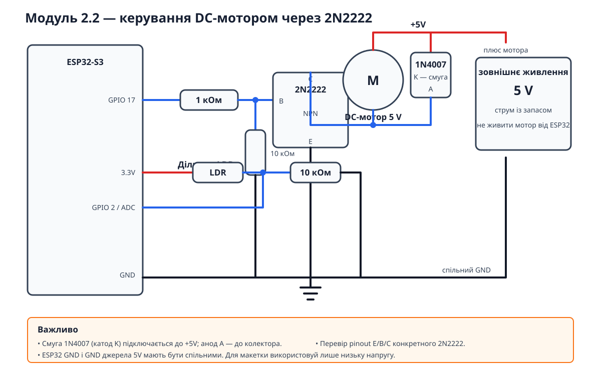

# Домашня робота — Завдання 2 (опційне)

## Software PWM для DC-мотора

Окремий проєкт: потенціометр на GPIO2 задає duty cycle, а GPIO17 формує
software PWM через `micros()` для 2N2222. Схема не пов’язана з реле.



### Підключення

```text
Потенціометр: VCC → 3.3V, SIG → GPIO2, GND → GND

GPIO17 ── 1 кОм ──┬── база 2N2222
                  └── 10 кОм ── GND
емітер 2N2222 ───────────── GND
колектор 2N2222 ─────────── мінус мотора
плюс мотора ─────────────── +5V зовнішнього джерела
```

1N4007 ставиться паралельно мотору: смуга до `+5V`, сторона без смуги до
колектора. Керамічний 100 нФ — паралельно клемам мотора без полярності.

GPIO4 передає UART-патерни `0x00`, `0x0F`, `0x55`, `0xFF` для Logic Analyzer.

### Збірка

```bash
cd lesson-10/homework/motor-pwm
pio run
```
