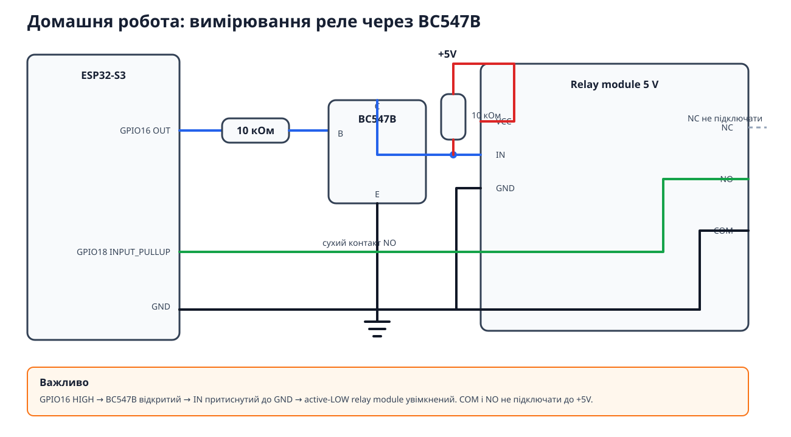

# Домашня робота — Завдання 1

## Вимірювання часу спрацювання реле

Це окремий проєкт для обов’язкової частини домашнього завдання. Він не
керує мотором і не використовує потенціометр.

### Підключення



Використовується попередня схема з готовим relay module та зовнішнім BC547B:

```text
GPIO16 ── 10 кОм ── база BC547B
емітер BC547B ────── GND
колектор BC547B ──── IN relay module
IN ── 10 кОм ─────── +5V

relay VCC ─────────── +5V
relay GND ─────────── GND

relay NO ──────────── GPIO18
relay COM ─────────── GND
relay NC ──────────── не підключати
```

BC547B інвертує сигнал: `HIGH` на GPIO16 тягне `IN` реле до GND і вмикає
active-LOW relay module. Транзистор усередині модуля вже керує котушкою.

GPIO18 працює як `INPUT_PULLUP`: розімкнений `NO` дає `HIGH`, замкнений —
`LOW`. На сухі контакти `COM/NO` не подається 5 V.

### Що робить код

- фіксує контакт через `attachInterrupt(..., CHANGE)`;
- використовує `micros()`;
- прибирає брязкіт контакту програмним debounce 10 мс;
- виконує один прогрівальний цикл без додавання до статистики;
- проводить 10 вимірювань ON і 10 OFF;
- виводить кожне значення та два середні результати.
- повторює повний прогін через 60 секунд після завершення.

`Relay` керує GPIO16. `RelayContact` читає GPIO18, обробляє interrupt і
debounce. `RelayStatistics` рахує цикли та середні значення. `RelayTester`
лише координує послідовність ON/OFF.

### Збірка

```bash
cd lesson-10/homework/relay-timing
pio run
pio run --target upload
pio device monitor
```

### Wokwi

Wokwi-схема використовує еквівалентне пряме керування relay module, бо не
моделює зовнішній BC547B у цій силовій схемі. Реальне підключення виконуй за
SVG вище. Wokwi також не відтворює реальну механічну затримку та брязкіт.
