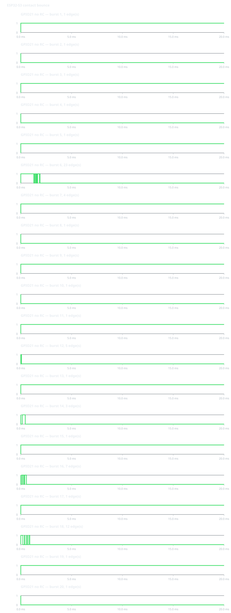
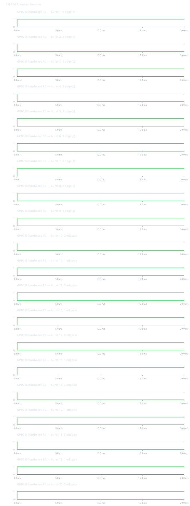

# ESP-IDF debounce comparison

Дві кнопки та два LED:

```text
GPIO21 without RC, internal pull-down -> GPIO12 LED
GPIO18 with external RC pull-down     -> GPIO16 LED
```

Обидві кнопки active-high. Для кожної паралельно працюють:

1. `No debounce`;
2. `Time-based`, 50 мс;
3. `Timer FSM`, interrupt + one-shot `esp_timer`;
4. `Polling FSM`, polling кожні 5 мс.

`Timer FSM` перемикає відповідний LED.

```bash
pio run
pio run -t upload
pio device monitor
```

Монітор показує логи та записує їх у `logs/device-monitor-*.log`.

Кожен raw edge також записується у форматі:

```text
WAVE,<button>,<timestamp_us>,<pressed>
```

Побудова цифрової осцилограми:

```bash
python3 tools/plot_bounce.py logs/device-monitor-*.log
```

Результат: `bounce-waveform.svg`. Переходи, розташовані ближче ніж 100 мс,
групуються в один burst; кожен burst показує щонайменше перші 20 мс.

## Результати

По 10 фізичних натискань кожної кнопки:

### GPIO21 без RC

| Метод | Подій | Хибних |
| --- | ---: | ---: |
| No debounce | 41 | 31 |
| Time-based | 15 | 5 |
| Timer FSM | 10 | 0 |
| Polling FSM | 10 | 0 |

### GPIO18 з hardware RC

| Метод | Подій | Хибних |
| --- | ---: | ---: |
| No debounce | 14 | 4 |
| Time-based | 14 | 4 |
| Timer FSM | 10 | 0 |
| Polling FSM | 10 | 0 |

Апаратний RC суттєво зменшив bounce: raw-лічильник знизився з 41 до 14.
Обидві FSM на обох входах дали рівно одну подію на фізичне натискання.
Після виправлення мінімальної FreeRTOS-затримки task watchdog не
спрацьовував.

## Осцилограма

Raw edges GPIO21 без RC, записані з timestamp у мікросекундах:



Raw edges GPIO18 з hardware RC:



Окремий канал можна вибрати під час генерації:

```bash
python3 tools/plot_bounce.py logs/device-monitor.log \
  --channel "GPIO18 hardware RC" \
  -o esp32-rc-waveform.svg
```
